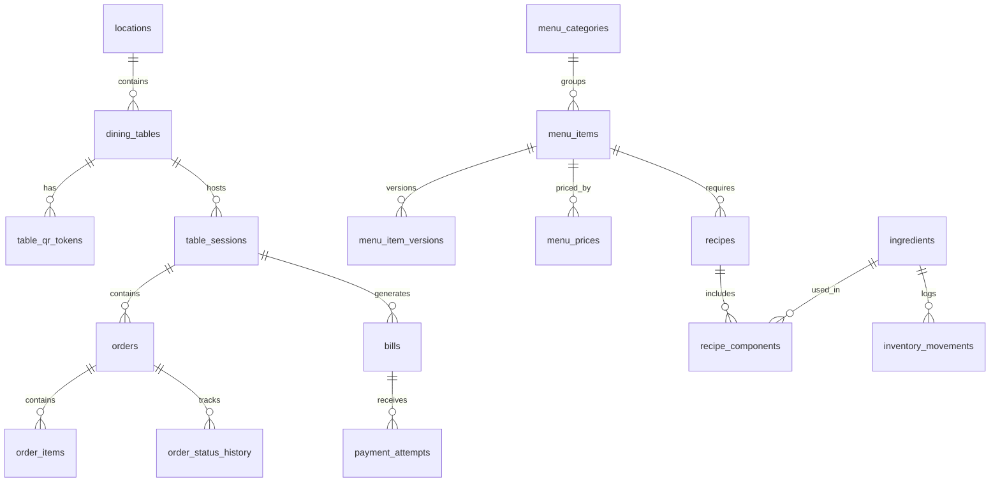
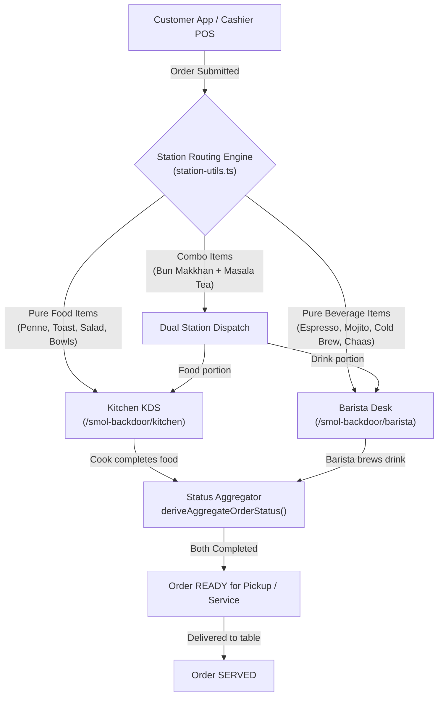

# ☕ Smol Café Rishikesh — Complete Technical & Functional Specification

> **Document Type:** Master System Architecture & Functional Specification  
> **Project:** Smol Café Rishikesh (Tapovan, Rishikesh, Uttarakhand, India)  
> **System Version:** v1.0 (Production Ready)  
> **Last Updated:** 29 October 2026  
> **Status:** Fully Implemented, Hardened & Verified  

---

## 📑 Table of Contents

1. [Executive Summary & Product Vision](#1-executive-summary--product-vision)
2. [High-Level Architecture & Tech Stack](#2-high-level-architecture--tech-stack)
3. [Monorepo Structure & Workspaces](#3-monorepo-structure--workspaces)
4. [Roles, Permissions & Security Architecture (RBAC)](#4-roles-permissions--security-architecture-rbac)
5. [Route Map & Endpoints Reference](#5-route-map--endpoints-reference)
6. [Database Schema & Data Architecture (15+ Tables & Enums)](#6-database-schema--data-architecture)
7. [Database RPCs, Transactions & Integer Paise Math](#7-database-rpcs-transactions--integer-paise-math)
8. [End-to-End Order & Station Routing Pipeline](#8-end-to-end-order--station-routing-pipeline)
9. [Kitchen Display System (KDS) & Chef Cookbook](#9-kitchen-display-system-kds--chef-cookbook)
10. [Barista Desk & Espresso Timer System](#10-barista-desk--espresso-timer-system)
11. [Cashier POS & Table Settlement System](#11-cashier-pos--table-settlement-system)
12. [Admin Tower Operations & Management](#12-admin-tower-operations--management)
13. [Customer Experience & Front-of-House (FoH)](#13-customer-experience--front-of-house-foh)
14. [Community Features: Blackboard, Events & Music Jukebox](#14-community-features-blackboard-events--music-jukebox)
15. [Inventory, Procurement & Budgeting Engine](#15-inventory-procurement--budgeting-engine)
16. [Real-Time Sync, Offline Resilience & Mock DB Engine](#16-real-time-sync-offline-resilience--mock-db-engine)
17. [Testing, Observability & Verification Suite](#17-testing-observability--verification-suite)
18. [Deployment, Environment Variables & Runbooks](#18-deployment-environment-variables--runbooks)

---

## 1. Executive Summary & Product Vision

### 1.1 About Smol Café
**Smol Café** is an artisan café and cultural community space located in Tapovan, Rishikesh, Uttarakhand, India. Built with a warm, Himalayan minimalist aesthetic (terracotta, forest moss greens, aged paper, and chalk typography), the café caters to conscious travelers, remote workers, yoga practitioners, and locals.

### 1.2 System Purpose & Philosophy
The **Smol Café Operating System** is a unified, real-time, local-first Point of Sale (POS), Kitchen Display System (KDS), Barista Workflow Terminal, Customer QR Portal, and Business Operations Suite.

**Core Philosophy & Operational Principles:**
- **Zero Friction at Tables:** Customers scan physical QR stands placed on tables (`/t/[tableToken]`) to browse 59 artisanal food and beverage items, see high-resolution imagery, dietary tags, allergens, and queue up orders.
- **Counter & Table Hybrid Ordering:** Orders can be placed directly by customers via QR or rung up by the cashier at the counter.
- **Intelligent Station Splitting:** Food items route automatically to the Kitchen KDS; hot/cold brews and beverages route to the Barista Desk; combo items (e.g. *Bun Makkhan + Masala Milk Tea*) automatically split across both stations.
- **Integer Paise Financial Precision:** Every financial amount (prices, taxes, discounts, totals) is stored and computed strictly in **integer paise** (₹1 = 100 paise) to eliminate IEEE-754 floating-point rounding errors.
- **High Security & Role Isolation:** Public users cannot access or view staff tools. Role-switcher bars are eliminated. Unauthenticated hits to staff URLs strictly bounce to `/smol-backdoor` PIN authentication.
- **Network Resilience:** Functions smoothly even under spotty Himalayan internet using local-first optimistic state, BroadcastChannel browser sync, and an automated in-memory Mock DB fallback.

---

## 2. High-Level Architecture & Tech Stack

```
┌────────────────────────────────────────────────────────────────────────┐
│                        CLIENT LAYER (Browsers & PWA)                   │
│  React 19 · Next.js 15 App Router · Tailwind CSS v4 · Lucide Icons     │
│  CartContext · BroadcastChannel API · LocalStorage Sync                │
└───────────────────────────────────┬────────────────────────────────────┘
                                    │ HTTPS / WSS
┌───────────────────────────────────▼────────────────────────────────────┐
│                    APPLICATION SERVER LAYER (Next.js)                  │
│  • Edge Middleware: Route protection, session cookie evaluation       │
│  • Server Actions: "use server" RPCs with requireStaffAuth() guards   │
│  • Dynamic API Routes: Razorpay webhooks, health checks, table sync    │
│  • Sentry Monitoring: Client, Server, and Edge tracing                 │
└───────────────────────────────────┬────────────────────────────────────┘
                                    │ PostgREST / Realtime WebSocket
┌───────────────────────────────────▼────────────────────────────────────┐
│                   PERSISTENCE LAYER (Supabase / Postgres)              │
│  • PostgreSQL 15+ (Hosted in AWS ap-south-1 Mumbai)                   │
│  • Row-Level Security (RLS) policies isolating roles                  │
│  • PL/pgSQL Atomic Procedures (submit_order_v2, record_cash_payment)   │
│  • Realtime Publication (CDC) streaming orders & bill updates         │
│  • In-Memory Mock DB Fallback for instant offline/dev execution        │
└───────────────────────────────────┬────────────────────────────────────┘
                                    │ Webhooks / API
┌───────────────────────────────────▼────────────────────────────────────┐
│                     EXTERNAL THIRD-PARTY SERVICES                      │
│  • Razorpay Payment Gateway (UPI QR, Cards, Netbanking)               │
│  • Sentry Error Tracing & Performance Telemetry                        │
└────────────────────────────────────────────────────────────────────────┘
```

### 2.1 Technology Matrix

| Layer | Technology | Version | Purpose |
|---|---|---|---|
| **Framework** | Next.js (App Router) | `15.5.23` | Server Components, Server Actions, Dynamic Routes |
| **Frontend Runtime**| React | `19.0.0` | Declarative UI, optimistic updates, Suspense |
| **Language** | TypeScript | `5.7.3` | Strict type safety across client, server, and DB |
| **Styling** | Tailwind CSS | `v4` | Himalayan theme tokens, responsive layouts, print styles |
| **Database** | PostgreSQL / Supabase | `15+` | Primary relational datastore, RLS, triggers, RPCs |
| **Real-Time CDC** | Supabase Realtime | `v2` | Change Data Capture (CDC) over WebSockets |
| **Browser Inter-Tab**| BroadcastChannel API | Native | Sub-millisecond synchronization across cashier & KDS tabs |
| **Payments** | Razorpay SDK & UPI Direct | Current | UPI QR deep links, Razorpay Orders & Webhooks |
| **Error Tracking** | @sentry/nextjs | `8.x` | Edge, client, and server exception tracking |
| **Package Manager**| npm Workspaces | `10.x` | Monorepo orchestrator |

---

## 3. Monorepo Structure & Workspaces

The project uses an `npm workspaces` monorepo configuration:

```
Smol-Cafe-Rishikesh/
├── apps/
│   └── web/                                # Next.js 15 Web Application
│       ├── app/                            # App Router routes & pages
│       │   ├── (customer routes)           # /, /menu, /drinks, /order-status, /bill, /t/...
│       │   ├── admin/                      # Admin Tower management routes
│       │   ├── barista/                    # Barista Desk beverage queue
│       │   ├── cashier/                    # Cashier POS & settlement terminal
│       │   ├── kitchen/                    # Kitchen KDS food queue
│       │   ├── smol-backdoor/              # Staff PIN & Master Password login portal
│       │   ├── api/                        # Health checks, Razorpay webhooks
│       │   └── layout.tsx & globals.css    # Root layout & styling
│       ├── components/                     # Modular React Components
│       │   ├── admin/                      # TableManager, StockManager, PaymentReconcile, etc.
│       │   ├── barista/                    # BaristaBoardView, EspressoShotTimer
│       │   ├── cashier/                    # CashierDashboard, ActiveOrders, PastBills
│       │   ├── kitchen/                    # KitchenBoardView, KitchenCookbookView
│       │   ├── menu/                       # MenuCatalog, ItemDetailModal, CategoryFilters
│       │   ├── cart/                       # CartDrawer, NotesTextarea
│       │   ├── orders/                     # OrderCard, OrderStatusClientView, OrderReceiptModal
│       │   └── ui/                         # Buttons, Modals, Badges, Dropdowns
│       ├── context/                        # CartContext, LoadingContext
│       ├── hooks/                          # useSupabaseRealtime, useNetworkHealth
│       ├── lib/                            # Server actions, station utils, auth, mock DB
│       │   ├── auth/                       # rbac.ts, credentials.ts
│       │   ├── mock-db/                    # Complete mock PostgREST bridge & seed data
│       │   ├── queries/                    # Menu, orders, tables, payments queries
│       │   ├── supabase/                   # Client & admin factory instances
│       │   ├── station-utils.ts            # Beverage routing & status aggregation
│       │   └── sync-events.ts              # BroadcastChannel & localStorage events
│       └── middleware.ts                   # Edge authentication & backdoor redirect engine
├── packages/
│   ├── db/                                 # Shared Database Package
│   │   ├── src/                            # TypeScript interfaces, schema enums, queries
│   │   ├── supabase/
│   │   │   └── migrations/                 # 25+ SQL migrations (tables, RLS, RPCs)
│   │   ├── seed/                           # Master CSV menu seed files
│   │   └── scripts/                        # Nightly backups, invariant tests, seeders
│   └── ui/                                 # Shared UI components
├── public/                                 # Static brand assets, logos, icons, PWA manifest
└── smol_cafe_qa_test_report.pdf            # Quality Assurance Signoff Report
```

---

## 4. Roles, Permissions & Security Architecture (RBAC)

The system implements strict, defense-in-depth Role-Based Access Control (RBAC).

```
┌────────────────────────────────────────────────────────┐
│                     USER REQUEST                       │
└───────────────────────────┬────────────────────────────┘
                            │
              [ Layer 1: Edge Middleware ]
         Is route naked (/admin, /kitchen, etc.)?
              ├── YES ──> Redirect 307 to /smol-backdoor
              └── NO
         Is route protected (/smol-backdoor/admin, etc.)?
              ├── YES ──> Check smol_staff_session cookie
              │           ├── Missing/Invalid ──> Redirect to /smol-backdoor
              │           └── Role permitted? ──> Allow Next
              └── NO ───> Allow Next (Customer Route)
                            │
             [ Layer 2: Server Action Boundary ]
         Does action modify sensitive staff data?
              └── Checked via requireStaffAuth([...roles])
                  ├── Unauthorized ──> Return { success: false, error: 401 }
                  └── Authorized ────> Execute DB Operation
                            │
             [ Layer 3: Supabase RLS Policies ]
         PostgreSQL Row-Level Security checks actor session
```

### 4.1 Role Matrix & Default Credentials

| Role | Role Name | Allowed Portal | Default PIN | Default Password | Granted Permissions |
|---|---|---|---|---|---|
| `admin` / `super_admin` | Super Admin (Owner) | `/smol-backdoor/admin` | `9227` | `smol2026` | Full Control, Budgets, Logs, Deletions, Table Config |
| `cashier` | Cashier / Counter Staff | `/smol-backdoor/cashier` | `8112` | — | Order Entry, Bill Settlement, Cash Receipts |
| `kitchen` | Kitchen Display (Chef) | `/smol-backdoor/kitchen` | `6175` | — | Food Queue, Prep Status, Recipe Cookbook |
| `barista` | Barista Desk | `/smol-backdoor/barista`| `1234` | — | Beverage Queue, Espresso Timer, Brew Status |
| `customer` | Guest / Table Diner | `/t/*`, `/menu`, `/bill` | — | — | Menu View, Cart Add, Jukebox Request, Event RSVP |

### 4.2 Security Rules Enforced:
1. **Naked Route Protection:** Direct hits to `/admin`, `/cashier`, `/kitchen`, `/barista` automatically bounce to `/smol-backdoor` via Edge Middleware.
2. **Hidden Role Switcher:** No public navigation bar exists that allows switching between Customer, Kitchen, Barista, Cashier, and Admin.
3. **PIN Masking:** `getRoleCredentialsAction()` returns `****` for all role PINs unless explicitly invoked by an authenticated `admin`.
4. **Server Action Hardening:** All critical actions (`deleteAdminOrderAction`, `deleteAdminPaymentAction`, `saveTableAction`, `updateOrderStatusAction`) invoke `requireStaffAuth()`.

---

## 5. Route Map & Endpoints Reference

### 5.1 Customer & Public Routes

| Route | Description | Dynamic Parameters / Notes |
|---|---|---|
| `/` | Landing / Welcome Experience | Himalayan hero visual, Quick link to Menu & Story |
| `/menu` | Full Visual Catalogue | All 59 items, category tabs, item modifiers modal |
| `/drinks` | Beverage-Exclusive Menu | Coffee, brews, coolers, teas, smoothies |
| `/smol-menu` | Compact Quick Menu | Lightweight text & price view for slow mobile networks |
| `/t/[tableToken]` | Table QR Scan Target | Resolves table ID, establishes `smol_table_session` cookie |
| `/table/[tableId]`| Direct Table Landing | Table session verification and redirect to menu |
| `/order-status` | Real-Time Order Tracker | Live progress bar (SUBMITTED → PREPARING → READY → SERVED) |
| `/bill` | Table Bill & Settle Portal | Itemized breakdown, GST breakdown, UPI QR generator |
| `/music` | Community Jukebox | Active song playing, queue, song upvoting |
| `/events` | Cultural Calendar | Upcoming live sets, workshops, RSVP registration |
| `/profile` / `/account`| Customer Profile | Phone OTP login, past order history, loyalty stamps |

### 5.2 Staff & Operations Routes (`/smol-backdoor/*`)

| Route | Authorized Roles | Functional Capability |
|---|---|---|
| `/smol-backdoor` | Public / Unauth | 4-digit PIN pad & admin password toggle to enter staff portals |
| `/smol-backdoor/cashier` | Cashier, Admin | 4 Tabs: Active Orders, Tables Overview & Settlement, Menu Quick-Add, Past Bills |
| `/smol-backdoor/kitchen` | Kitchen, Admin | Real-time food tickets, timer alerts, complete 59-item Chef Cookbook |
| `/smol-backdoor/barista` | Barista, Admin | Real-time beverage queue, drink category filters, Espresso Shot Timer |
| `/smol-backdoor/admin` | Admin, Super Admin | Admin Tower: Overview, Orders, Tables, Menu, Stock, Staff, Payments, Rewards |
| `/admin/tables` | Admin | Dedicated Table Management & QR Stand generation |
| `/admin/procurement` | Admin | Vendor Purchase Orders and Goods Receipts |
| `/admin/budgets` | Admin | Monthly departmental spending caps & variance |
| `/admin/blackboard` | Admin | Edit daily chalk blackboard announcements |
| `/admin/observability` | Admin | System latency, database query times, Sentry logs |

---

## 6. Database Schema & Data Architecture

The database runs on PostgreSQL (Supabase) in the `ap-south-1` (Mumbai) region.



### 6.1 Core Relational Tables

#### 1. `dining_tables`
Represents physical seating tables in the café.
- `id` (UUID, Primary Key)
- `location_id` (UUID, FK to `locations`)
- `label` (VARCHAR, e.g., `"Table T-01"`, `"Garden Balcony"`)
- `seats` (INTEGER, default 2)
- `section` (VARCHAR, e.g., `"Dining Tables"`, `"Balcony"`, `"Indoor"`)
- `active` (BOOLEAN, default true)
- `created_at`, `updated_at` (TIMESTAMPTZ)

#### 2. `table_qr_tokens`
Cryptographic tokens embedded into physical QR stickers on tables.
- `id` (UUID, Primary Key)
- `table_id` (UUID, FK to `dining_tables`)
- `token_hash` (VARCHAR, Unique)
- `version` (INTEGER, default 1)
- `revoked_at` (TIMESTAMPTZ, nullable for instant QR rotation)

#### 3. `table_sessions`
Active occupancy lifecycle of a table.
- `id` (UUID, Primary Key)
- `table_id` (UUID, FK to `dining_tables`)
- `status` (ENUM: `'OPEN'`, `'PAYMENT_PENDING'`, `'CLOSED'`, `'EXPIRED'`)
- `opened_at` (TIMESTAMPTZ)
- `closed_at` (TIMESTAMPTZ, nullable)
- `guest_count` (INTEGER)
- `bill_id` (UUID, FK to `bills`, nullable)

#### 4. `menu_categories` & `menu_items`
- `menu_categories`: `id`, `name`, `sort_order`, `is_active`
- `menu_items`: `id`, `category_id`, `name`, `status` (`'ACTIVE'`, `'OUT_OF_STOCK'`, `'ARCHIVED'`), `metadata` (JSONB)
- `metadata` JSONB Schema:
  ```json
  {
    "dietary": "VEG | NON_VEG | VEGAN | GLUTEN_FREE",
    "spice": "MILD | MEDIUM | SPICY",
    "station": "KITCHEN | BARISTA | DUAL",
    "prep_time_minutes": 10,
    "core_ingredients": "Espresso, Steamed Oat Milk",
    "allergens": ["DAIRY", "NUTS"],
    "chef_special": false
  }
  ```

#### 5. `menu_prices`
- `id` (UUID, Primary Key)
- `menu_item_id` (UUID, FK to `menu_items`)
- `amount_paise` (INTEGER, strictly in paise, e.g., ₹250 = `25000`)
- `currency` (VARCHAR, default `'INR'`)
- `effective_from`, `effective_to` (TIMESTAMPTZ)

#### 6. `orders`
The central ledger entry for every customer or staff order ticket.
- `id` (UUID, Primary Key)
- `order_no` (INTEGER / SERIAL, human-readable display e.g. `#104`)
- `table_session_id` (UUID, FK to `table_sessions`)
- `customer_id` (UUID, nullable)
- `verification_code` (VARCHAR(4), e.g. `"4821"`)
- `status` (ENUM: `'DRAFT'`, `'SUBMITTED'`, `'CONFIRMED'`, `'PREPARING'`, `'READY'`, `'SERVED'`, `'CANCELLED'`, `'REJECTED'`)
- `service_mode` (VARCHAR: `'DINE_IN'`, `'TAKEAWAY'`)
- `instructions` (TEXT, custom preparation notes from guest or cashier)
- `subtotal_snapshot` (INTEGER, paise)
- `tax_snapshot` (INTEGER, paise)
- `total_snapshot` (INTEGER, paise)
- `submitted_at`, `confirmed_at`, `ready_at`, `served_at` (TIMESTAMPTZ)
- `idempotency_key` (VARCHAR, Unique, prevents duplicate submission)

#### 7. `order_items`
Line items attached to an order.
- `id` (UUID, Primary Key)
- `order_id` (UUID, FK to `orders`)
- `menu_item_id` (UUID, FK to `menu_items`)
- `name_snapshot` (VARCHAR, exact item name at purchase)
- `unit_price_snapshot` (INTEGER, paise)
- `qty` (INTEGER)
- `line_subtotal` (INTEGER, paise)
- `item_status` (VARCHAR: `'PENDING'`, `'PREPARING'`, `'READY'`, `'SERVED'`, `'CANCELLED'`)
- `metadata` (JSONB, stores pasta shape, modifier notes, customization)

#### 8. `bills` & `payment_attempts`
- `bills`: `id`, `table_session_id`, `subtotal`, `tax`, `total`, `paid_amount`, `status` (`'UNPAID'`, `'PARTIALLY_PAID'`, `'SETTLED'`, `'VOID'`)
- `payment_attempts`: `id`, `bill_id`, `provider` (`'CASH'`, `'UPI_DIRECT'`, `'RAZORPAY'`), `amount`, `status` (`'CREATED'`, `'PENDING'`, `'CAPTURED'`, `'FAILED'`, `'REFUNDED'`), `idempotency_key`

#### 9. Auxiliary Tables
- `inventory_items` & `inventory_movements`: Real-time stock counts and movement audits (`RECEIVE`, `CONSUME`, `WASTE`, `ADJUST`).
- `loyalty_accounts` & `loyalty_ledger`: Points ledger for repeat visitors.
- `blackboard_posts`: Digital daily chalkboard announcements.
- `cafe_events` & `event_rsvps`: Cultural workshop events and guest registrations.
- `music_sessions`, `song_requests`, `song_votes`: Real-time interactive guest Jukebox.
- `vendors`, `purchase_orders`, `procurement_budgets`: Café B2B supply chain procurement.

---

## 7. Database RPCs, Transactions & Integer Paise Math

To prevent race conditions, double submissions, and floating-point math rounding bugs, all financial and ticket submission actions execute inside atomic PostgreSQL functions.

### 7.1 Integer Paise Rule
- **1 Rupee = 100 Paise**
- Example: An Americano priced at ₹160 is stored as `16000` paise.
- GST (5% total: 2.5% CGST + 2.5% SGST) calculation:
  $$\text{Tax Paise} = \operatorname{round}\left(\frac{\text{Subtotal Paise} \times 5}{100}\right)$$
- Rendering on UI: `(amountPaise / 100).toLocaleString('en-IN', { style: 'currency', currency: 'INR' })`.

### 7.2 `submit_order_tax` Stored Procedure
This PL/pgSQL function handles:
1. Validating table session status (`OPEN`).
2. Checking idempotency key to prevent double-click submissions.
3. Fetching live prices from `menu_prices` and calculating item subtotals.
4. Computing 5% GST snapshot.
5. Inserting the parent row in `orders`.
6. Inserting individual rows in `order_items` with initial status `'PENDING'`.
7. Logging status change into `order_status_history`.
8. Updating `table_sessions.last_activity_at`.

---

## 8. End-to-End Order & Station Routing Pipeline

### 8.1 Dispatch & Routing Architecture



### 8.2 Station Routing Rules (`station-utils.ts`)

1. **Beverage Detection (`isBeverageItem`):**
   - Category keywords: `coffee`, `brew`, `chai`, `tea`, `drink`, `beverage`, `barista`, `shake`, `cooler`, `smoothie`, `kombucha`, `refresher`, `mocktail`, `juice`, `fizz`.
   - Item name keywords: `espresso`, `americano`, `latte`, `cappuccino`, `mocha`, `cortado`, `flat white`, `pour over`, `aeropress`, `cold brew`, `mojito`, `chaas`, `buttermilk`, `hot chocolate`, `lemonade`, `soda`.
2. **Combo Split Detection (`isComboWithFoodItem`):**
   - Detects `+` separator combined with bakery or breakfast items: e.g. `"Bun Makkhan + Masala Milk Tea"`, `"Cookie + Cappuccino"`.
   - **Kitchen ticket displays:** `[COMBO FOOD] Bun Makkhan (+ Masala Milk Tea)`.
   - **Barista ticket displays:** `[COMBO DRINK] Masala Milk Tea (+ Bun Makkhan)`.
3. **Aggregate Status Derivation (`deriveAggregateOrderStatus`):**
   - If Kitchen is `PREPARING` and Barista is `PENDING`, whole order status is `PREPARING`.
   - Whole order only transitions to `READY` when **both** Kitchen and Barista have marked their respective items ready.
   - Whole order only transitions to `SERVED` when both stations have marked served.

---

## 9. Kitchen Display System (KDS) & Chef Cookbook

**Route:** `/smol-backdoor/kitchen`  
**Target Device:** 10" or 12" Android / iPad tablet mounted in the kitchen.

### 9.1 Visual & Functional Capabilities
- **Live Ticket Cards:** Display Table #, Order #, Elapsed Timer (with color shift: Green `<10m`, Amber `10-20m`, Red `>20m`), Service Mode (`DINE_IN` vs `TAKEAWAY`).
- **Custom Customer Instructions:** Prominently highlights custom customer instructions (e.g., *"Make pasta less spicy, no onions"*).
- **Sound Alerts:** Triggers an audio chime when a new order ticket arrives.
- **One-Click Item & Order Toggles:** Kitchen staff can tap individual items to mark them done, or tap `Mark All Ready` to clear the ticket.

### 9.2 Complete 59-Item Chef Cookbook Modal
Clicking the `📖 Chef Cookbook` button opens the instant recipe reference for all 59 catalog items:
- Ingredients with exact metric measurements (grams, ml).
- Preparation sequence step-by-step.
- Required cookware / station equipment (e.g. Salamander grill, induction, blender).
- Plating & serving ware guidance (e.g., Terracotta bowl, craft wooden tray).
- Allergen warnings.

---

## 10. Barista Desk & Espresso Timer System

**Route:** `/smol-backdoor/barista`  
**Target Device:** Tablet or mobile device mounted on the espresso bar.

### 10.1 Beverage Ticket Queue
- Filter pills to isolate queues: `All`, `Black Coffee`, `Mocha`, `Sodas`, `Shakes`, `Smoothies`, `Chai & Tea`.
- Shows bean origin, grind setting notes, and temperature preference (`HOT` vs `ICED`).

### 10.2 Integrated Espresso Shot Timer (`EspressoShotTimer.tsx`)
- Digital millisecond-accurate timer designed specifically for pulling espresso shots.
- Target Extraction Windows:
  - 18g In / 36g Out in **25s to 30s**.
- High contrast dark/light mode toggle for clear visibility under bright bar lights.
- Zero CPU thrashing: Timer hook uses requestAnimationFrame / optimized interval decoupled from UI re-renders.

---

## 11. Cashier POS & Table Settlement System

**Route:** `/smol-backdoor/cashier`  
**Target Device:** Counter POS PC or 12.9" iPad.

### 11.1 The 4 Core Dashboard Tabs

```
┌────────────────────────────────────────────────────────────────────────┐
│ [ Active Orders (KDS) ]  [ Dining Tables ]  [ Quick Add ]  [ Past Bills ] │
└────────────────────────────────────────────────────────────────────────┘
```

1. **Tab 1: Active Orders:**
   - Real-time list of all live orders across all tables.
   - Shows kitchen and barista completion percentages.
   - Instant Cashier voiding & editing capabilities.
2. **Tab 2: Dining Tables & Settlement:**
   - Visual grid of all tables in the café with status badges:
     - 🟢 **Available / Idle:** Table empty, ready for new guests.
     - 🟡 **Dining / Active:** Guests have unbilled orders running.
     - 🔴 **Payment Pending:** Guests requested bill; settlement required.
   - One-click `Settle & Free Table` with instant cash receipt generation.
3. **Tab 3: Menu Quick-Add:**
   - Rapid counter ordering with search, category filtering, pasta shape picker, and cooking notes.
4. **Tab 4: Past Bills Ledger:**
   - Complete historical ledger of every transaction.
   - View/reprint thermal bills.
   - Real-time search by Order No, Bill ID, or Table.

### 11.2 Payment Modes Supported
- **Cash Settlement:** Cashier enters received cash amount; system calculates change and marks bill `SETTLED`.
- **UPI Direct Dynamic QR:** Renders live UPI QR with merchant VPA (`smolcafe@upi`), exact order amount, and transaction reference.
- **Razorpay Online Gateway:** Credit/Debit Cards, Netbanking, Wallets.

---

## 12. Admin Tower Operations & Management

**Route:** `/smol-backdoor/admin`  
**Access:** Owner / Super Admin (`PIN: 9227`, `Password: smol2026`).

### 12.1 Operational Panels

1. **Overview & Analytics:**
   - Real-time Gross Revenue, Net Average Order Value (AOV), Total Orders, and Table Turn Rate.
2. **Payments Reconciliation Log:**
   - Full ledger with Transaction ID, Payment Method, Amount, Order Ref, Status, and Timestamp.
   - **Void & Refund Action:** Robust handling of UUID vs `ORD-` string formatting to prevent Postgres `22P02` syntax crashes.
   - **`Export Ledger (CSV)`:** Dynamically generates and downloads an `.csv` file formatted for café chartered accountants.
3. **Table Manager & QR Stand Generator (`TableManager.tsx`):**
   - Add, edit, or disable café tables with live loading feedback (`Adding Table...`) that waits for DB confirmation before closing modal.
   - Generates high-resolution Printable Table QR Stand cards.
   - Host URL Presets: `https://www.smolcafe.in`, `Active App Host`, `Localhost (:3000)`.
4. **Menu & 86 Inventory Manager:**
   - Instant toggle to mark any item `86 / Out of Stock`, syncing immediately to customer QR menus.
   - Price adjustments and category reordering.
5. **Staff Access & Credentials Manager:**
   - View and update PINs and master passwords for all 4 roles.
6. **Grocery & Procurement Manager:**
   - Ingredient low-stock warnings (e.g. Oat Milk, Arabica Coffee Beans).
   - Monthly category budget tracking (Dairy, Coffee, Bakery, Spices, Packaging).

---

## 13. Customer Experience & Front-of-House (FoH)

### 13.1 QR Stand Scan to Table Session
1. Customer points phone camera at table QR card: opens `https://smolcafe.in/t/<token>`.
2. Token is verified against `table_qr_tokens`.
3. System writes encrypted `smol_table_session` cookie containing `{ tableId, tableLabel, sessionVersion }`.
4. Browser redirects to `/menu` with active table context header (*"Seated at Table 04"*).

### 13.2 Visual Menu & Item Customization
- Category quick-scroll: *Himalayan Breakfast, Sourdough Toasts, Handcrafted Pasta, Small Plates, Artisanal Coffee, House Coolers, Desserts*.
- Dietary Badges: Vegan 🌱, Vegetarian 🟢, Gluten-Free 🌾, Chef's Special ⭐.
- **Pasta Customization:** Shape selector modal (*Penne, Farfalle, Spaghetti*) without item UUID corruption.
- **Cart Drawer (`CartDrawer.tsx`):**
  - Quantity steppers.
  - Dedicated **"Cooking Instructions / Special Requests"** textarea.
  - Clear itemized price breakdown (Subtotal, GST 5%, Total).

---

## 14. Community Features: Blackboard, Events & Music Jukebox

### 14.1 Daily Community Blackboard (`/admin/blackboard`)
- Styled as a dark green slate blackboard with handwritten chalk typography (`Caveat` font).
- Admin posts daily specials, Himalayan weather notes, or philosophical quotes of the day.

### 14.2 Cultural Events Calendar (`/events`)
- Lists acoustic live music nights, meditation circles, pour-over coffee workshops.
- Guests can RSVP directly with their name and phone number.

### 14.3 Guest Music Jukebox (`/music`)
- Interactive digital jukebox for café guests.
- Upvote currently queued ambient, acoustic, and lo-fi tracks.
- Prevents spam: limited to 1 song suggestion per table session every 30 minutes.

---

## 15. Inventory, Procurement & Budgeting Engine

### 15.1 Real-Time Ingredient Depletion
When an order moves to `PREPARING`, the database trigger resolves the recipe for each `menu_item_id` and records an `InventoryMovement` of type `CONSUME`.

### 15.2 Monthly Category Budgets
Procurement budgets track spend across 6 core café operational categories:
1. `COFFEE_BEANS` (Estate washed Arabica, Robusta blends)
2. `DAIRY` (A2 Cow milk, Oat milk, Almond milk, Butter)
3. `BAKERY_RAW` (Organic flour, sourdough starter, chocolate)
4. `SPICES_TEA` (Kangra green tea, Masala chai spices)
5. `PACKAGING` (Compostable cups, craft paper bags)
6. `MISC` (Cleaning, gas, equipment maintenance)

---

## 16. Real-Time Sync, Offline Resilience & Mock DB Engine

### 16.1 Three-Tier Synchronization Engine

```
                                  Order Placed
                                       │
            ┌──────────────────────────┼──────────────────────────┐
            ▼                          ▼                          ▼
   [ Supabase Realtime ]      [ BroadcastChannel ]       [ LocalStorage Events ]
   Postgres CDC WebSocket     Zero-latency browser tab   Cross-window storage key
   updates remote devices     sync on same computer      fallback for older browsers
   (Cashier POS <-> Kitchen)  (Cashier tab <-> POS tab)
```

1. **Tier 1 — Supabase Realtime CDC (`useSupabaseRealtime.ts`):**
   - Subscribes to Postgres `INSERT`, `UPDATE`, `DELETE` events on `orders`, `order_items`, and `dining_tables`.
2. **Tier 2 — Browser BroadcastChannel (`sync-events.ts`):**
   - Instant channel named `smol_cafe_sync` communicates state changes between open browser tabs on the same device in `<1ms`.
3. **Tier 3 — LocalStorage Fallback:**
   - Broadcasts timestamped storage keys for environments where WebSockets drop temporarily.

### 16.2 In-Memory Mock DB Bridge (`lib/mock-db/`)
- When `NEXT_PUBLIC_SUPABASE_URL` or `SUPABASE_SERVICE_ROLE_KEY` are unset or inaccessible, the application automatically mounts its complete in-memory mock database.
- Pre-seeded with:
  - All 59 authentic Smol Café menu items with high-resolution imagery and descriptions.
  - 12 active dining tables across Dining and Balcony sections.
  - Staff credentials and mock orders.
- Implements full fluent PostgREST chaining (`.from().select().eq().order().limit()`), guaranteeing zero crash during local offline development.

---

## 17. Testing, Observability & Verification Suite

### 17.1 Quality Assurance Suite
The repository includes dedicated verification scripts in `packages/db/scripts/`:
- `test-release-blocking-invariants.ts`: Validates integer paise math, total calculations, and schema integrity.
- `test-role-matrix-negative.ts`: Executes negative testing verifying that cashier/kitchen/barista tokens cannot mutate admin records.
- `test-webhook-dedupe.ts`: Verifies Razorpay webhook idempotency by sending repeated webhook payloads.
- `test-refund-lifecycle.ts`: Tests payment voiding and refund workflows.

### 17.2 Production Build Validation
Every build is strictly verified:
```bash
# Type check without compilation
npx tsc --noEmit

# Production build validation
npm run build
```
Build guarantees:
- 0 TypeScript errors across all workspaces.
- All 34 Next.js App Router routes compile cleanly as dynamic (`ƒ`) or static (`○`).
- Edge Middleware size kept under Next.js size limits (~34.4 kB).

---

## 18. Deployment, Environment Variables & Runbooks

### 18.1 Environment Configuration (`.env.local`)

```env
# Supabase Configuration
NEXT_PUBLIC_SUPABASE_URL="https://your-project.supabase.co"
NEXT_PUBLIC_SUPABASE_ANON_KEY="eyJhbGciOi..."
SUPABASE_SERVICE_ROLE_KEY="eyJhbGciOi..."

# Authentication & Security
STAFF_SESSION_SECRET="your-32-character-secret-key"
NEXT_PUBLIC_APP_URL="https://www.smolcafe.in"

# Razorpay Payment Gateway
NEXT_PUBLIC_RAZORPAY_KEY_ID="rzp_live_..."
RAZORPAY_KEY_SECRET="your_razorpay_secret"
RAZORPAY_WEBHOOK_SECRET="your_webhook_secret"

# Sentry Monitoring
NEXT_PUBLIC_SENTRY_DSN="https://...@sentry.io/..."
SENTRY_AUTH_TOKEN="your_sentry_token"
```

### 18.2 Production Runbook

#### 1. First-Time Setup & Seeding
```bash
# Install all dependencies across monorepo
npm install

# Run database migrations
cd packages/db
npx supabase migration up

# Seed complete 59-item menu catalog
npx ts-node scripts/seed-menu.ts
```

#### 2. Running Local Development
```bash
# Start Next.js development server
npm run dev
# Server boots at http://localhost:3000
```

#### 3. Emergency Staff Access
If credentials are forgotten:
1. Navigate to `http://localhost:3000/smol-backdoor`.
2. Toggle to "Super Admin".
3. Enter default Master PIN: `9227` or Master Password: `smol2026`.
4. Navigate to Staff settings to view or update credentials.

---

> **Smol Café Rishikesh © 2026** — Handcrafted with love & code for Tapovan, Rishikesh.

